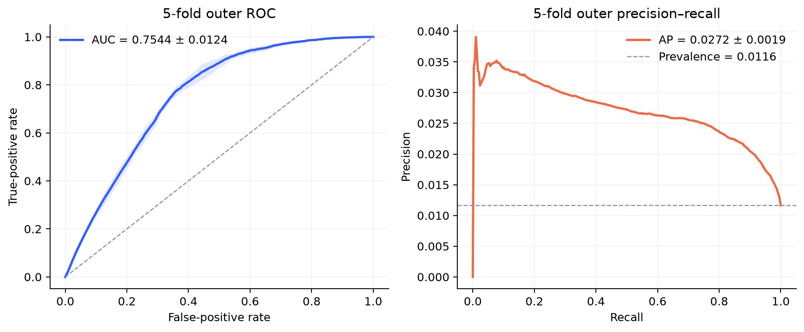

# GraphShield：抗泄漏图金融反欺诈

GraphShield 面向一个包含 **579,157 个节点、167,559 条有向边、11 种已观测关系**
的金融网络，比较 GCN、GraphSAGE、GIN、R-GCN、GAT 五类模型。标注数据中只有
4,492 个欺诈节点，欺诈率约 **1.16%**。

这个项目最值得呈现的并不只是模型数量，而是一次完整的科研判断过程：加入所谓
“时间特征”后指标异常升高，于是进一步审计数据，而不是直接把高分写进简历。

## 核心结论

- 原始 `data.npz` 没有任何具有明确语义的时间戳字段。
- 4,492 个已标注欺诈节点的 ID 全部位于 `0–6784`。
- 381,612 个已标注正常节点的 ID 全部位于 `6785–579156`。
- 只用节点 ID 排序即可得到 **ROC-AUC 1.0000**。
- 因此，节点 ID、邻居 ID 和边在文件中的行顺序不能被解释成真实时间。

这更符合“数据按类别拼接后保存”的特征，而不是“越早注册越容易欺诈”的证据。
项目现在默认关闭所有时间代理，只允许通过白名单启用有数据字典、单位、时区、事件
语义以及预测时可用性说明的真实时间字段。

## 可公开的结果

已经完成严格的五折外层验证。每个外层训练折内部再次划分拟合集与早停集，外层验证
节点既不参与训练，也不参与早停或阈值选择；节点 ID 和边顺序代理全部关闭。

| 指标 | 五折均值 ± 标准差 |
|---|---:|
| ROC-AUC | **0.7544 ± 0.0124** |
| PR-AUC / Average Precision | **0.02718 ± 0.00193** |
| F1（阈值仅由内层验证集选择） | **0.0515 ± 0.0076** |
| MCC（阈值仅由内层验证集选择） | **0.0438 ± 0.0104** |

PR-AUC 是随机基线 `0.01163` 的约 **2.34 倍**。完整机器可读结果位于
[`artifacts/graphsage_oof/metrics.json`](artifacts/graphsage_oof/metrics.json)。



旧课程报告的 GraphSAGE 单次留出集 ROC-AUC `0.7803`、PR-AUC `0.0300` 只保留为
历史对照；接近 `1.0` 的旧图表不应上传。

## 时间信息应该怎样继续做

时间仍然可以成为项目亮点，但必须按以下方式验证：

1. 获得具有明确业务语义的真实时间戳；
2. 只在训练折拟合时间归一化；
3. 对比“结构基线”和“结构 + 真实时间”；
4. 增加按时间向前留出的验证集和 purge gap；
5. 把节点 ID、边顺序作为负对照，而不是生产特征；
6. 同时报告 ROC-AUC 与更适合极端不平衡问题的 PR-AUC。

完整实验矩阵见 [`docs/EXPERIMENT_PROTOCOL.md`](docs/EXPERIMENT_PROTOCOL.md)。

## 运行

```bash
export GRAPHSHIELD_DATA=/absolute/path/to/data.npz
python scripts/audit_dataset.py "$GRAPHSHIELD_DATA"
python scripts/run_graphsage_oof.py --data "$GRAPHSHIELD_DATA"
python stacking.py
```

无需私有数据即可运行泄漏与数据划分守卫测试：

```bash
pip install -e '.[dev]'
pytest -q
```

审计脚本只依赖 NumPy，可以在训练前单独运行。数据文件不应上传 GitHub；原因与字段
契约见 [`data/README.md`](data/README.md)。

## 简历表述

> 在 57.9 万节点、多关系金融图上构建抗泄漏欺诈检测流水线，对比五类 GNN，并在
> 1.16% 欺诈率下完成 60+ 结构特征和 OOF Stacking；发现类别排序导致的节点 ID
> “时间代理”可将 ROC-AUC 虚增至 1.00，进一步实现代理变量置换检验、真实时间字段
> 白名单和嵌套留出评估；在五个完全未参与训练、早停和阈值选择的外层验证折上，
> GraphSAGE 达到 ROC-AUC `0.7544 ± 0.0124`、PR-AUC `0.02718 ± 0.00193`。
